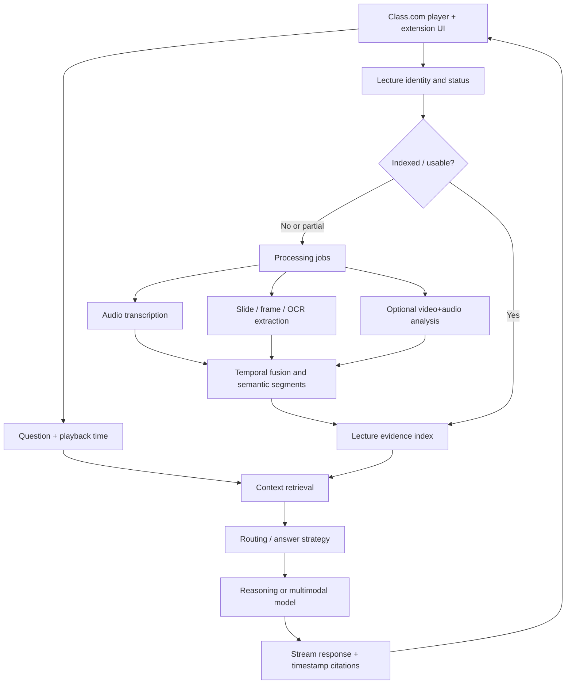

# Blackboard Tutor Extension — Project Context

## 1. Product vision

Build a browser extension that helps University of Arkansas students study while watching recorded Blackboard lectures. The extension offers two primary capabilities:

1. **Recording download:** Present a simple, user-initiated action to download a lecture recording the student is authorized to access.
2. **Context-aware AI tutor:** Show a sidebar chat alongside the recording. The tutor should understand the *current playback position*, the professor's speech, and relevant on-screen slides/equations/diagrams. It should answer questions, explain difficult concepts, and cite or link back to specific lecture timestamps.

**Product differentiation:** This is not intended to be a general-purpose ChatGPT clone or an unlimited chat wrapper. The value is *time-synchronized, multimodal understanding of the specific lecture being watched*.

### Example experience

A student pauses an abstract linear algebra lecture at 24:30 and asks, "Why doesn't this matrix have enough eigenvectors?" The tutor should retrieve the professor's nearby explanation and the visible matrix, reason through the calculation, answer at an appropriate level, and offer a timestamp link to revisit the relevant derivation.

## 2. Product scope

### In scope capabilities

- Detect the active lecture and derive a **stable lecture identity**.
- Offer an explicit Download action.
- Render a sidebar with conversational history scoped to the recording.
- Track the current playback timestamp and use it to ground questions such as "What does this mean?"
- Transcribe lecture speech and capture time-aligned visual evidence (slides, equations, diagrams, code).
- Build a reusable index of the lecture for time-based and semantic retrieval.
- Return grounded answers with source timestamps and, where helpful, a visual reference.
- Keep the model/provider layer replaceable. Use specialist models only when they improve quality or efficiency.

### MVP success criteria

1. Student opens a supported recording and sees a working Download action and tutor UI.
2. Tutor can answer questions about the **current moment** using nearby transcript text and at least a representative current/nearby frame.
3. Responses include usable timestamps and do not silently invent lecture-specific facts.
4. Existing lecture processing is reused across questions; refreshes do not trigger duplicate jobs.
5. Clear loading, partial-readiness, and error states; student can still watch the recording if AI processing fails.

## 3. Current repository state

This section documents **implemented code**, not planned functionality.

**Draft status:** The current Phase 2 ingestion and playback-aware tutoring implementation is a rough functional draft. Phase 4 will revisit and improve its architecture, retrieval quality, user experience, and production readiness.

| File/path | Present behavior |
|---|---|
| `manifest.json` | Manifest V3; registers a dedicated service worker and an all-frame content script on the existing `https://*.class.com/*` scope. Permissions are limited to `webRequest`, `downloads`, and `storage`. |
| `src/background.ts`, `src/background/` | Observes supported Class.com MP4 requests, keeps signed URLs in ephemeral `chrome.storage.session`, restores state after service-worker suspension, automatically initiates local ingestion on the first consented question, orchestrates downloads, and relays cross-frame playback updates. |
| `src/content.ts`, `src/content/` | Detects player surfaces, follows single-page navigation, selects the active media element, tracks playback time across supported frames, and owns the toolbar/sidebar DOM. |
| `src/shared/lectureIdentity.ts` | Derives stable recording/session/meeting identities from page metadata and media paths, with a query-free page fallback. Signed URLs are never lecture identities. |
| Download flow | Prefers the shared-screen MP4, uses `chrome.downloads`, sanitizes filenames, rejects links close to expiry, and reports starting, active, completed, expired, and failed states with recovery guidance. |
| Tutor UI | Provides toolbar controls and an isolated Shadow DOM sidebar with lecture/media and Phase 2 processing status, live playback time, a copyable lecture ID, explicit evidence-sharing consent, transcript-only versus multimodal strategy selection, grounded answers, timestamp seek links, and per-answer model/token/cost traces. Questions are limited to the current moment and preceding 10 minutes; full-lecture requests are redirected to the recording download workflow. The full-height sidebar is horizontally resizable and reserves bounded page width so the player expands and contracts with it. |
| `server/` | Runs the local Phase 2 HTTP API, acquires the authorized recording from the extension on the first consented question, creates timestamped ASR transcript evidence when captions are not supplied, persists lecture/job/artifact records, retrieves already-watched evidence with temporal/lexical/semantic ranking, validates returned citations, and appends privacy-conscious cost traces. |
| `phase2-data/` | The ignored private Phase 2 store contains an atomic registry plus versioned metadata, transcript, scene-frame, segment, and embedding artifacts. Managed source media is deleted after successful ingestion. |
| `tests/`, `package.json`, `tsconfig.json` | Strict TypeScript, pure identity/media tests, deterministic bundling, and a single `npm run check` verification command. |
| `dist/` | Generated service-worker and content-script JavaScript referenced by the manifest. |

**Important:** Phase 2 is a durable local implementation, not a deployed multi-user cloud system. On the first consented question, it acquires the user-authorized MP4 that the extension observed and sends bounded audio chunks to the configured ASR provider when a timestamped transcript is needed. Signed URLs are sent only to the local API and never to a model provider, page context, or logs. It has bounded local job leases/retries but no authentication, remote worker fleet, or shared cross-user index. The download path supports authorized MP4 assets that the Class.com player requests in the student's browser; it does not bypass access controls or consolidate adaptive streams.

### Phase 0 extension architecture

- DOM and playback interactions live in a dedicated content script; the service worker does not inject UI code.
- The service worker is limited to browser APIs, request observation, ephemeral media state, download orchestration, and cross-frame messaging.
- The sidebar uses isolated Shadow DOM styles plus one reversible page-layout class that reserves its current width. Resizing is bounded to preserve usable space for the lecture player, and closing the sidebar restores the full page width.
- Service-worker suspension is handled with session storage, and content code detects player single-page navigation.
- Product logic validates Class.com hosts without hardcoding the University of Arkansas tenant or broadening manifest access.

## 4. High-level architecture

Two main lifecycles are intentionally separate:

1. **Setup / ingestion:** Detect lecture, check existing state, acquire authorized media, process streams, and publish searchable evidence.
2. **Conversation:** Receive a timestamped student question, retrieve relevant evidence, select an answer strategy/model, stream a grounded answer, and persist permitted conversation state.



**Guiding principle:** The index stores **time-aligned evidence and pointers to originals**, not just a generated summary. Summaries, topic labels, and embeddings are derived, fallible artifacts.

## 5. Processing + indexing pipeline (primary design area)

### 5.1 Register and deduplicate

When a supported player is visited:

1. Extract platform/course/recording identifiers from stable page or player metadata when legitimately accessible.
2. Register the lecture with a stable ID, **not the expiring signed MP4 URL**.
3. Check ingestion status, artifact versions, and usable capabilities.
4. Use an idempotent job key and database lock/lease to prevent duplicate processing across tabs or refreshes.
5. Begin processing on trigger.

**Current trigger for MVP:** On first chat request. Do not initiate costly transcription just because a page is open.

### 5.2 Acquire and inspect media

- Determine whether the accessible recording is one MP4 with synchronized audio/video or multiple separate streams.
- Inspect duration, codecs, track layout, and timeline offsets using FFmpeg/ffprobe or equivalent tooling.
- Preserve original playback timestamps in all derived artifacts; explicitly record any offsets introduced by transcoding or stream extraction.
- Signed URLs may expire and may require browser-held authorization. Do not assume a remote server can fetch them directly. Define a user-authorized transfer or in-browser processing pathway before committing to a cloud pipeline.
- Avoid unnecessary long-term retention of raw recordings. Apply expiration, encryption, and cleanup rules.

### 5.3 Specialized extractors (parallelizable)

**Audio worker — baseline**
- Speech-to-text with timestamps (e.g., WhisperX or a managed ASR provider).
- Optional word alignment, speaker diarization, and cleanup.
- Preserve raw segments, confidence/quality metadata where available, and original times.

**Visual worker — baseline**
- Detect slide/scene changes and select representative frames; avoid fixed-rate analysis of every frame.
- Extract visible text, code, mathematical notation/LaTeX, diagrams, and slide intervals.
- Use conventional frame comparison before invoking vision/OCR models; invoke mathematical OCR selectively.
- Retain source frame IDs and time intervals so answers can refer to what the viewer saw.

**Multimodal interpretation worker — selective**
- Analyze video/audio jointly for ambiguous explanations, gestures, changing diagrams, or phrases such as "substitute this here."
- Candidate provider families include Gemini video understanding and dedicated video-retrieval systems such as TwelveLabs. Model choice, current capabilities, availability, and pricing must be verified at implementation time.
- Run on selected segments or on demand, not automatically on an entire recording by default.

### 5.4 Temporal fusion and segmentation

Use the common lecture timeline to connect:

- Transcript utterances / word ranges.
- Slide visibility intervals and selected frames.
- OCR/equation evidence.
- Topic transitions and optional joint audio-video interpretations.

Build **semantic lecture segments** around actual concept boundaries, not only arbitrary 30–60 second chunks. Keep short overlapping retrieval windows when beneficial and preserve references to raw evidence.

Illustrative segment (not an implemented schema):

```json
{
  "segment_id": "seg_0042",
  "lecture_id": "classcom:recording-12345",
  "start_seconds": 767.5,
  "end_seconds": 815.2,
  "topic": "Matrix diagonalization",
  "transcript_refs": ["utt_170", "utt_171"],
  "visual_refs": ["slide_007", "frame_01305"],
  "equations_latex": ["A = PDP^{-1}"],
  "summary": "Requirements for diagonalization",
  "pipeline_version": 1
}
```

### 5.5 Search indexing

Start with three complementary retrieval methods:

- **Temporal:** Retrieve the segment at the current playback position, plus appropriate lead-in and subsequent context already watched.
- **Lexical:** Exact technical terms, symbols, keywords, and equation strings.
- **Semantic:** Embeddings for paraphrases, explanations, and topic-level questions.

Rank evidence using question intent, timestamp distance, textual relevance, and visual relevance. Return specific citations to source times and evidence IDs. Begin with text embeddings; add video/image embeddings only if experiments show measurable benefit.

### 5.6 Publish incrementally

Represent processing as independent stage statuses, not a single `processed = true` flag.

Possible states: `not_started`, `queued`, `processing`, `ready`, `failed`.

Every job needs durable status, retry/backoff, cancellation/timeout, failure reason, and processing/prompt/model version.

## 6. Conversation stage

At each user message, send only the information necessary to ground the question:

- Lecture ID and the user's authorization context.
- Playback timestamp and, where needed, most recently watched interval.
- User question and bounded conversation history.
- Optional attached current screenshot or explicit selection.

### Suggested request flow

1. Classify question intent with cheap rules first; use a lightweight classifier only if needed.
2. Reject full-lecture analysis, explicit references more than 10 minutes back, and vague lecture-wide references that cannot fit inside the recent context window.
3. Retrieve nearby timestamp evidence for deictic questions ("this", "here", "what he just said") and lexical/semantic evidence from at most the preceding 10 minutes.
4. Rerank and assemble concise context, with transcript snippets, slide descriptions, images, and equations as available.
5. Route to a capable text/reasoning or multimodal model based on the **evidence needed**; avoid invoking every model on every question.
6. Stream the response to the sidebar, including relevant timestamps, confidence/uncertainty, and evidence references.
7. Save conversation state subject to privacy/retention settings; cache reusable results without leaking one student's private conversation to another.

When the user asks about the current moment, prefer **already watched** context and don't reveal later lecture material by default. If evidence is missing or unreliable, say so and ask for a screenshot or permission to inspect a broader time interval instead of fabricating specifics.

### Example output contract (conceptual)

```json
{
  "answer": "The matrix is not diagonalizable because ...",
  "citations": [
    { "start_seconds": 1410, "end_seconds": 1510, "evidence_ids": ["utt_42", "slide_8"] }
  ],
  "used_modalities": ["transcript", "slide"],
  "limitations": []
}
```

## 7. Proposed implementation stack (not yet chosen or installed)

| Layer | Suggested starting point | Notes |
|---|---|---|
| Browser | Chrome Manifest V3, TypeScript | Existing foundation; refactor into service worker + content script + sidebar UI. |
| Client-side UI | Lightweight component library or React | Choose based on bundling/DOM isolation needs. |
| Backend/API | Python + FastAPI | Useful for media processing and model SDKs. Backend may be deferred for a local-first prototype. |
| Background jobs | Redis + Dramatiq/Celery | Only once asynchronous cloud ingestion is needed. |
| Media tools | FFmpeg / ffprobe | Stream inspection, extraction, resampling, frame sampling. |
| Structured storage | PostgreSQL | Lectures, users/access, jobs, evidence references, conversations. |
| Search | PostgreSQL full-text + pgvector | Start simple; avoid a separate vector DB prematurely. |
| Media storage | S3 | Store only what is necessary, with limited retention. |
| ASR | WhisperX or managed service | Evaluate quality on noisy class recordings. |
| Vision / joint video | Replaceable multimodal model | Benchmark; Should not be required for every segment. |
| Answer generation | Replaceable cheap LLM API | Verify auth, plan allowances, pricing, and commercial terms; |

## 8. Conceptual data entities

- `Lecture`: stable platform identity, course metadata, duration, ownership/access metadata, pipeline version.
- `MediaAsset`: authorized source reference, stream type, offset, object key, retention date.
- `ProcessingJob`: lecture, job type, status, attempts, dependency/artifact versions, error, lease.
- `TranscriptUtterance`: start/end, speaker (if known), text, optional word alignment.
- `VisualAsset`: frame/slide, visible interval, object key, OCR text, detected equations.
- `LectureSegment`: start/end, topic, summary, references to raw transcript/visual evidence.
- `SearchDocument`: segment/evidence reference, text, embedding/version, search metadata.
- `Conversation` and `Message`: lecture- and user-scoped chat, timestamps, cited evidence.
- `LectureAccess`: explicit per-user access grants; distinct from canonical content identity.

Consider indexes on `(lecture_id, start_seconds, end_seconds)`, job idempotency keys, and embedding version. Never equate "same video ID" with "same access rights."

## 9. Security, privacy, and responsible media use

- Process only recordings the student is authorized to access. Respect university policies, copyright, provider terms, and any content protection.
- Require clear disclosure/consent before transmitting lecture audio, video, slides, or classmates' voices/images to external AI services.
- Request minimal Chrome permissions; scope allowed origins tightly and avoid leaking signed stream URLs in telemetry.
- Do not store long-lived media URLs or browser session tokens unencrypted. Do not send cookies or other browser secrets to model providers.
- Separate model-provider credentials from the content-script/page context. Do not embed shared secret API keys in distributable extension code.
- Limit uploads, model requests, file sizes, rate, and storage; define cost controls per user/lecture.
- Delete temporary media and derived sensitive artifacts according to explicit retention policy; protect private conversations.
- Treat transcripts, web page text, and model outputs as untrusted content, especially when used in prompts or rendered in the sidebar.

## 10. Performance and cost principles

- **Process once, reuse often** within the same authorized context.
- Run inexpensive deterministic methods before expensive model calls.
- Avoid retranscribing/reembedding when unchanged stages already have matching versions.
- Apply processing budgets, clip/window limits, cache policies, and job concurrency limits.
- Stream answer tokens, but don't block the chat UI waiting for every enrichment stage.
- Benchmark transcription accuracy, equation fidelity, timestamp citation accuracy, answer groundedness, response latency, and dollar cost per lecture and per question.

## 11. Phased implementation plan

### Phase 0 — Strengthen extension skeleton
- **Status: complete.**
- Separate service worker from content script and UI.
- Identify lecture ID and player playback time robustly.
- Make Download functional on supported, authorized media; handle signed URL expiry and failures.
- Replace sidebar placeholder with a working interactive UI.

### Phase 1 — End-to-end contextual tutor experiment
- **Status: complete as a local experiment.** A provider key and private lecture evidence are required for a live run and are intentionally not committed.
- Test one accessible lecture with an ASR transcript and representative slide frames.
- Build a minimal chat path that uses current timestamp + extracted evidence.
- Compare a transcript-only model with a model receiving both transcript and visuals.
- Add timestamp links and inspect actual answer quality on technical lectures.

### Phase 2 — Durable ingestion and retrieval
- **Status: complete as a durable local implementation.** Cloud authentication, remote media transfer, and multi-user workers remain later deployment work.
- Add lecture/job/artifact records and persistent storage.
- Add transcript timestamps, slide-change detection, semantic segments, and baseline embeddings.
- Support partial readiness, retries, and reuse without duplicate jobs.

### Phase 3 — Cloud service and managed access
- **Status: planned.** Replace the developer-operated local API with a secure multi-user cloud service so extension users do not need to create or supply model-provider API keys.
- Deploy an authenticated HTTPS API for lecture registration, media transfer, processing status, tutor questions, citations, and usage status.
- Authenticate users to the Blackboard Tutor service and issue short-lived application session tokens. A user session must never receive, select, lease, or directly use a model-provider credential.
- Use one project service-account credential initially, stored only in a managed secret store and available only to the cloud API and workers. Add credential rotation and least-privilege access. Additional credentials are for operational rotation or isolation, not for assigning one provider key to each active user session.
- Add a durable relational database for users, sessions, lecture access, processing jobs, artifact metadata, idempotency keys, budget reservations, and finalized usage entries.
- Add encrypted object storage for authorized source media and derived artifacts, with explicit retention periods and deletion jobs.
- Run ingestion and answer generation through a durable job queue with bounded retries, leases, global concurrency limits, and per-user/session rate limits.
- Implement an application-owned shared credit balance. Before starting billable work, atomically reserve a conservative maximum cost; reject the request when the available balance cannot cover the reservation. After completion, settle the reservation against recorded provider usage and return unused credit. Failed or indeterminate jobs must resolve their reservation through an explicit reconciliation path.
- Configure provider-side spend alerts and a hard project spend limit as defense in depth. The application budget ledger remains the immediate request gate because alerts do not stop traffic and provider enforcement may not provide request-level reservation semantics.
- Return a clear service-unavailable or credits-exhausted state when shared credit reaches zero. Do not silently fall back to a user-supplied key.
- Add abuse controls, request-size limits, audit events that exclude lecture content and secrets, operational health monitoring, and an emergency global kill switch for new billable work.
- Define and test the consented browser-to-cloud media handoff without sending signed media URLs, browser cookies, or session credentials to model providers.
- Deploy separate development and production environments with isolated databases, object storage, provider projects, credentials, and spending controls.

**Credential design decision:** Do not build a pool that leases provider API keys to user sessions. Provider credentials identify the server application and stay behind the cloud boundary; application sessions, authorization, rate limits, and credit accounting provide user isolation. OpenAI recommends project service accounts for application identity and keeping credentials in environment variables or a secret-management service.

**Initial budget behavior:** The shared credit ledger is a product-level allowance, not a claim that each provider key has a separate balance. When available credit reaches zero—or is fully reserved by in-flight jobs—the service rejects new billable work. A later phase can replace this shared allowance with per-user plans, grants, or paid usage without changing provider credential handling.

### Phase 4 — Product polish, multimodal refinement, and expansion
- Improve mathematical OCR, selective joint audio/video interpretation, multimodal retrieval, and model routing only when benchmarks justify them.
- Add chat history, exportable notes, guided practice, broader player support, stronger privacy controls, observability, and a sustainable per-user cost model.
- Refine the Phase 3 authentication, budget, abuse-prevention, retention, and operational workflows using production evidence.

## 12. Open architectural decisions

These are **not finalized**; future work should explicitly resolve them:

1. **Processing location:** Phase 3 targets a **cloud-first service** for managed credentials, shared processing, and multi-user operation. Preserve a local development mode, but do not require it for extension users.
2. **Processing trigger:** on page open, first question, or explicit opt-in? Current inclination: **first question/consent**, with current-playback prioritized.
3. **Media acquisition:** which authorized stream(s) are accessible and how can they be transferred or processed without relying on expiring browser URLs?
4. **Transcript sources:** does Class.com expose accessible captions/transcripts that could make ASR unnecessary? From what I've seen, it does, but I'm not certain if this is configurable per class/lecture/university, so my current inclination is: Look for available transcription - if not available, resort to ASR.
5. **Multimodal coverage:** full lecture, selected segments, or on-demand only? Current inclination: **selected/on-demand**.
6. **Index ownership:** private per user initially versus access-controlled shared processing across students? I think in the future, access-controlled shared processing would reduce our costs dramatically.
7. **Retention:** how long to retain original media, frames, transcripts, and conversations?
8. **Session identity:** which authentication method should the extension use, and how are sessions revoked across devices?
9. **Shared-credit administration:** how is credit funded, who can adjust it, how are stale reservations reconciled, and what operational threshold should stop new work before the provider limit is reached?
10. **Deployment and pricing:** which features stay free versus metered or subscription-backed after the initial shared allowance?
